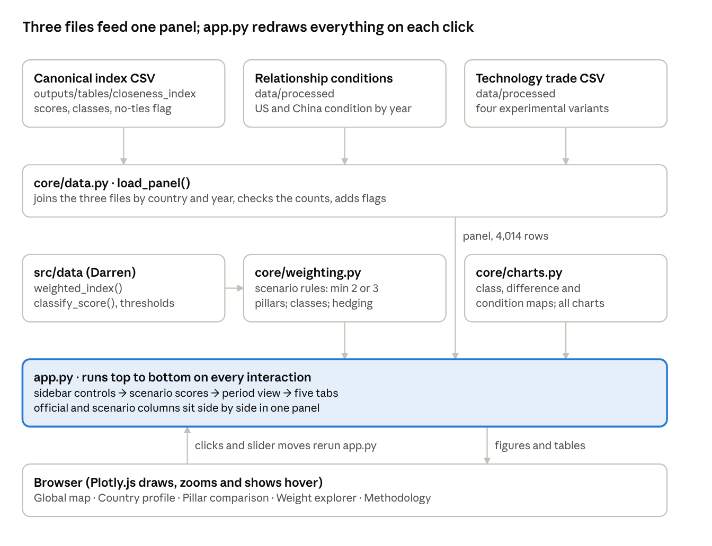

# US-China Relative Orientation Index

A reproducible country-year index showing whether countries' international relationships lean relatively toward the **United States** or **China**, with an interactive Streamlit dashboard for exploring the results.

**Course:** DS608 Data Analytics for Economics  
**Comparable period:** 2004-2024  
**Direction:** Positive = US-oriented, negative = China-oriented  
**Current automated validation:** 137 tests passed

## Project overview

The official index combines three pillars:

1. **Security**
2. **Diplomatic**
3. **Economic**

The three pillars receive equal requested weights of one-third each. A country-year requires at least two of the three pillars. Missing pillars are never replaced with zero; the remaining weights are renormalised and the resulting two-pillar score is explicitly flagged.

| Item | Production treatment |
|---|---|
| Official available-core index | Security, diplomatic, and economic pillars, with at least 2 of 3 available |
| Strict comparison | Requires all 3 official pillars |
| Coverage | 4,014 official country-year scores; 3,548 strict three-pillar scores |
| Country universe | 192 eligible entities across the panel; 191 eligible entities in 2024 |
| Technology | Experimental ICT-goods trade orientation, 3,322 country-years; excluded from the official benchmark |
| Relationship condition | Contextual overlay only; never changes the numerical index |

The canonical outputs are documented in:

- [`docs/decision_register.md`](docs/decision_register.md)
- [`docs/workstream1_findings.md`](docs/workstream1_findings.md)
- [`docs/workstream2_findings.md`](docs/workstream2_findings.md)

## Fixed orientation classes

The production classification uses a symmetric central band and side-specific Jenks natural breaks. Thresholds are fixed across 2004-2024 and are never recalculated by year.

| Class | Continuous official score |
|---|---:|
| Strongly China-oriented | `score <= -0.2550873926` |
| Moderately China-oriented | `-0.2550873926 < score <= -0.05` |
| Neutral or mixed pillar orientation | `-0.05 < score < +0.05` |
| Moderately US-oriented | `+0.05 <= score < +0.2708862274` |
| Strongly US-oriented | `score >= +0.2708862274` |

Within the central band:

- **Neutral** means there is no material opposing pillar pattern.
- **Mixed pillar orientation** means at least one official pillar is `>= +0.05` and another is `<= -0.05`.

## Dashboard

### Install and run

From the repository root:

```bash
python3 -m venv .venv
source .venv/bin/activate
python -m pip install -r requirements.txt
python -m streamlit run dashboard/app.py
```

On Windows PowerShell, activate the environment with:

```powershell
.venv\Scripts\Activate.ps1
```

The dashboard opens at [http://localhost:8501](http://localhost:8501). Internet access is required for map boundaries.

### Dashboard views

| View | Contents |
|---|---|
| Global map | Official, strict, scenario, difference, single-pillar, and relationship-condition views; fixed classes; small-state markers; hover and click interactions |
| Country profile | Historical official score, pillar values, relationship condition, classification, and coverage detail |
| Pillar comparison | Side-by-side comparison of countries and official pillar values |
| Weight explorer | User-selected weights, effective weights, comparison with the official benchmark, and class transitions |
| Methodology and coverage | Index construction, missing-data rules, fixed thresholds, mixed-orientation rule, and coverage |

### Scenario rules

- Reset weights are one-third each for security, diplomatic, and economic, and zero for technology.
- Any positive technology weight creates an **Experimental user-weighted scenario**.
- Missing pillars are never treated as zero.
- Scenario weights are renormalised over observed positively weighted pillars.
- A score is missing when no positively weighted pillar is available.
- The official benchmark remains visible and is never overwritten by a scenario.

### Dashboard architecture



- `dashboard/app.py` is the Streamlit entry point.
- `dashboard/core/data.py` loads and validates the canonical index and contextual data.
- `dashboard/core/weighting.py` builds scenarios using production functions from `src/data/`.
- `dashboard/core/charts.py` renders Plotly maps and charts.
- `dashboard/assets/` contains small-state map coordinates.
- `.streamlit/config.toml` defines the dashboard theme.

The dashboard reads the canonical classified panel and does not write data back to the repository:

```text
outputs/tables/closeness_index/us_china_relative_orientation_index_classified.csv
```

## Index construction

| Pillar or feature | Components | Method documentation |
|---|---|---|
| Security | Institutional security ties and five-year SIPRI arms-transfer orientation | [`docs/data_acquisition/security_subindex.md`](docs/data_acquisition/security_subindex.md) |
| Diplomatic | Diplomatic structural ties and relative UN General Assembly voting alignment | [`docs/data_acquisition/diplomatic_subindex.md`](docs/data_acquisition/diplomatic_subindex.md) |
| Economic | Merchandise trade, FDI structural orientation, and economic institutional orientation | [`docs/data_acquisition/economic_subindex.md`](docs/data_acquisition/economic_subindex.md) |
| Technology, experimental | ICT-goods trade orientation adjusted with anchor domestic-value-added shares | [`docs/data_acquisition/technology_trade_implementation_notes.md`](docs/data_acquisition/technology_trade_implementation_notes.md) |
| Relationship condition, contextual | Sanctions, trade restrictions, diplomatic disruption, payment restrictions, and other adverse evidence | [`docs/decision_register.md`](docs/decision_register.md) |

### Official index production

The official continuous panel is built with:

```bash
python -m src.data.build_closeness_index
```

The fixed classifications and reproducible diagnostics are built with:

```bash
python -m src.data.build_orientation_classification
```

The development notebooks are:

```text
notebooks/19_final_us_china_closeness_index.ipynb
notebooks/20_orientation_classification.ipynb
```

## Selected pipeline notes

### Merchandise trade

- annual bilateral imports and exports with both anchors;
- country-reported values prioritised;
- anchor-reported mirror observations used where the corresponding country flow is unavailable;
- incomplete four-flow observations remain missing; and
- official orientation is bounded within `[-1, 1]`.

### FDI

- IMF Direct Investment Positions;
- fixed reporting regime by country;
- host-official historical extension from 2009 where coverage supports it;
- common fixed-regime period from 2018-2024; and
- unavailable positions remain missing.

### Security arms transfers

- SIPRI major-arms transfers from 1996-2025;
- complete five-year rolling windows;
- non-state recipients removed and state names mapped to ISO3;
- score calculated as `(US TIV - China TIV) / Global TIV` over the rolling window; and
- no observed arms imports remain missing rather than neutral.

### Experimental technology

- native reporter-year HS classifications from HS1992 through HS2022;
- official UNCTAD ICT product baskets;
- pooled ICT-goods trade values;
- TiVA domestic-value-added adjustment; and
- excluded from the official benchmark because accessible ICT-specific data cannot reassign foreign value added by country of origin.

## Repository structure

```text
dashboard/        Streamlit dashboard
src/data/         Collection, processing, integration, and classification scripts
notebooks/        Development notebooks 01-20 in pipeline order
tests/            Pipeline, index, classification, and dashboard tests
data/             Raw, interim, processed, reference, and versioned source data
outputs/tables/   Audit tables and canonical production outputs
docs/             Decision register, findings, source register, and method notes
.streamlit/       Dashboard theme
AI_USAGE.md       Generative AI disclosure
CONTRIBUTIONS.md  Team contribution record
```

## Testing

Run the complete suite from the repository root:

```bash
python -m pytest -q
```

At the final dashboard merge, the suite reported:

```text
137 passed
```

Run the final index, classification, and dashboard tests only:

```bash
python -m pytest -q \
  tests/test_closeness_index.py \
  tests/test_orientation_classification.py \
  tests/test_dashboard_weighting.py
```

## Known limitations

- The experimental technology feature measures ICT-goods trade orientation, not comprehensive technological capability.
- Accessible ICT-specific TiVA data discount foreign value added but do not reassign it to its country of origin.
- Official two-pillar scores contain less evidence than strict three-pillar scores and should remain visibly flagged.
- A security score of zero can mean no measured security ties to either anchor; the explicit status field should be used for interpretation.
- Relationship condition is contextual and must not be interpreted as a numerical input to the index.
- Some relationship-condition classifications reflect broad sanctions evidence that may include targeted or multilateral measures.
- Map boundaries require an internet connection.

## Documentation

- [`docs/decision_register.md`](docs/decision_register.md): formal methodological decisions
- [`docs/workstream1_findings.md`](docs/workstream1_findings.md): official-core and technology audit
- [`docs/workstream2_findings.md`](docs/workstream2_findings.md): neutral-band and Jenks analysis
- [`docs/source_register.md`](docs/source_register.md): source inventory
- [`docs/data_acquisition/`](docs/data_acquisition/): component-level method notes
- [`AI_USAGE.md`](AI_USAGE.md): AI assistance and human verification
- [`CONTRIBUTIONS.md`](CONTRIBUTIONS.md): team contribution record

## API credentials

The UN Comtrade collector requires a personal API key. Copy the example file and add a private key:

```bash
cp .env.example .env
```

```text
COMTRADE_API_KEY=replace_with_your_own_key
```

Do not commit `.env`.

Run the merchandise-trade collector from the repository root using the documented script and arguments in `docs/data_acquisition/`.
